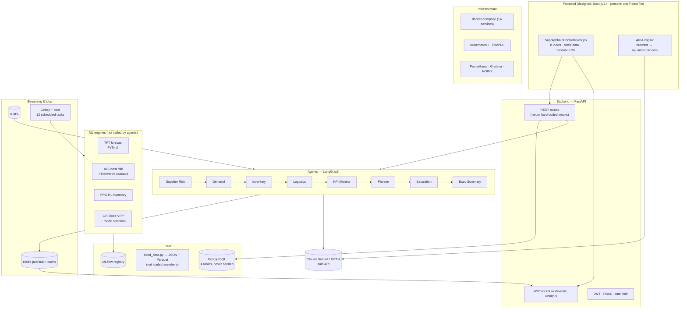
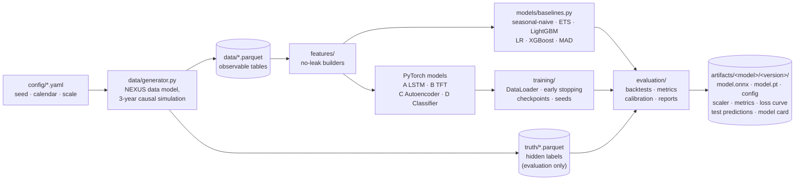
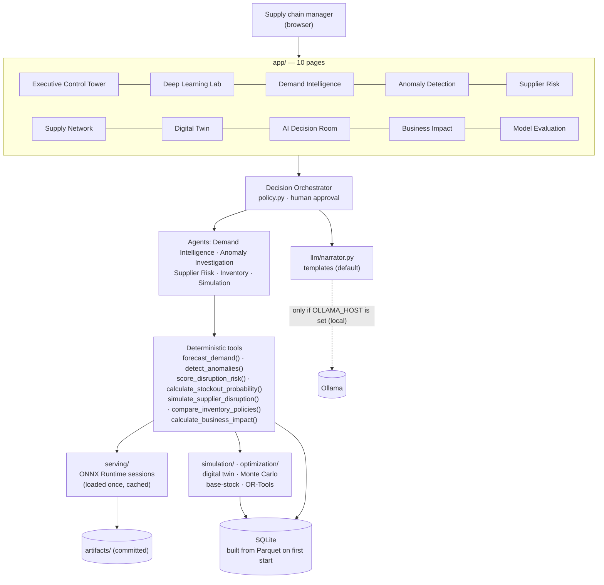

# Architecture

This project has two architectures on purpose:

- **Architecture A** is how the reference project, [NEXUS-SCCT](https://github.com/ahmedzainsyed/nexus-scct), is *designed* (from its README and code).
- **Architecture B** is what this repository — **SupplyChain Lens** — *builds*: the same control-tower product and data model, re-engineered around trained deep-learning models, running for ₹0, and fully reproducible.

Both diagrams use Mermaid, which GitHub renders automatically.

---

## Architecture A — NEXUS-SCCT as designed

**Reading the diagram honestly.** The arrows show the *intended* design. In the repository as published, the backend can't start (missing modules), the routes return mock data, the seed data is never loaded, and the agents never call the ML engines. The evidence for each of these is in [`audit/AUDIT_REPORT.md`](../audit/AUDIT_REPORT.md).

---

## Architecture B — SupplyChain Lens (deep-learning-first, ₹0)

*Updated 2026-10-27: deep-learning-first portfolio ([ADR-0008](adr/0008-deep-learning-first-portfolio.md)), separate training and inference environments ([ADR-0009](adr/0009-training-vs-inference-environments.md)), 6 agents ([ADR-0005](adr/0005-tool-grounded-agents.md)), 10 pages.*

### B.1 Training environment (your laptop, CPU)

### B.2 Inference environment (Streamlit Community Cloud, no PyTorch)

### Design rules for Architecture B

1. **Numbers come from code or trained models; words can come from an LLM.** Every figure in a recommendation is computed by a tool. The LLM (when present) only rewrites the explanation and must cite the tool outputs it was given.
2. **The app works with no API key and no LLM.** Template narration is the default; Ollama is an optional local upgrade.
3. **Heavy work happens offline.** Training, tuning, backtests and baseline simulations run in the training environment. The app loads small artifacts with ONNX Runtime and caches them. Live computation is bounded (for example, a scenario simulation of a few hundred runs).
4. **Reproducible by default.** Fixed random seed *and* fixed snapshot date, so the same commit always produces the same data, numbers and screenshots.
5. **Same data model as NEXUS.** The generator reproduces the NEXUS entities, reference tables and distributions; every deviation is documented in the data dictionary (Phase 2).
6. **Every chart has an artifact behind it.** If a model hasn't been trained, its page says so instead of showing placeholder numbers.
7. **PyTorch never runs on the public host.** Models are exported to ONNX and served with ONNX Runtime.

### Component mapping A → B

| Concern | Architecture A | Architecture B | Decision record |
|---|---|---|---|
| UI | Next.js / single React file | Streamlit + Plotly | [ADR-0003](adr/0003-streamlit-ui.md) |
| Database | PostgreSQL | SQLite | [ADR-0002](adr/0002-sqlite-and-no-streaming-stack.md) |
| Streaming, cache, jobs | Kafka, Redis, Celery | Event table + replay, Streamlit cache, offline pipeline | [ADR-0002](adr/0002-sqlite-and-no-streaming-stack.md) |
| LLM | Claude / GPT-4 (paid) | Templates + optional Ollama | [ADR-0004](adr/0004-llm-optional-templates-and-ollama.md) |
| Agents | 8 LLM-only nodes | 6 tool-grounded agents | [ADR-0005](adr/0005-tool-grounded-agents.md) |
| Forecasting | TFT (PyTorch, never trained) | Own LSTM and compact TFT, both trained, vs seasonal-naive / ETS / LightGBM | [ADR-0008](adr/0008-deep-learning-first-portfolio.md) |
| Anomaly detection | — | Autoencoder vs robust z-score | [ADR-0008](adr/0008-deep-learning-first-portfolio.md) |
| Supplier risk | XGBoost (generator crashes) | Neural classifier vs logistic regression vs XGBoost | [ADR-0008](adr/0008-deep-learning-first-portfolio.md) |
| Model serving | MLflow registry, PyTorch | Artifact folders, ONNX Runtime | [ADR-0009](adr/0009-training-vs-inference-environments.md) |
| Inventory | PPO RL (inference incompatible) | Base-stock / EOQ + OR-Tools + Monte Carlo; optional PPO on the digital twin | [ADR-0008](adr/0008-deep-learning-first-portfolio.md) |
| Data | Generator not used by app; 1 year | Same generator model, fixed, extended to 3 years, loaded | [ADR-0007](adr/0007-same-data-model-with-documented-fixes.md) |
| Code reuse | — | Reimplement + attribute until license confirmed | [ADR-0001](adr/0001-license-and-reuse-strategy.md) |
